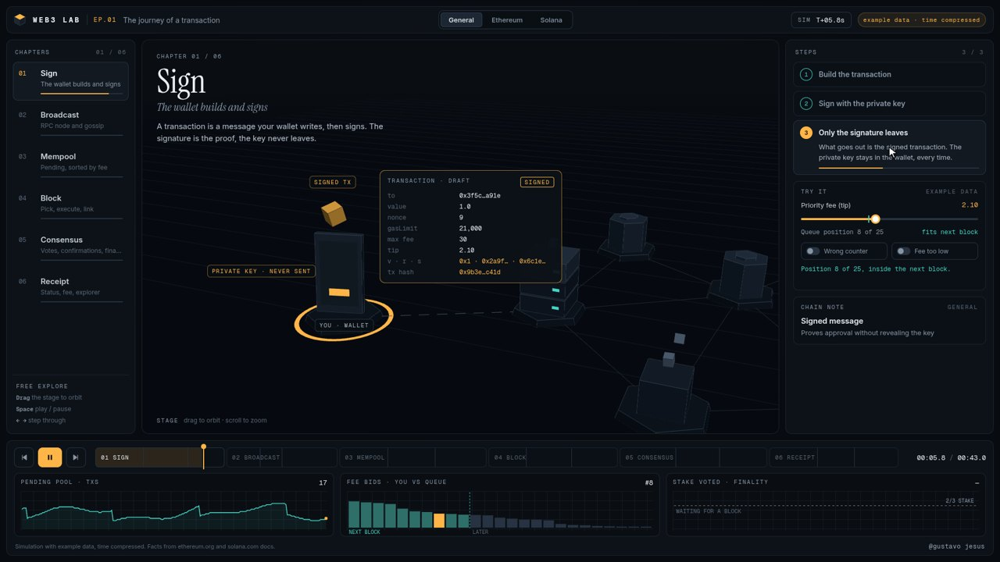
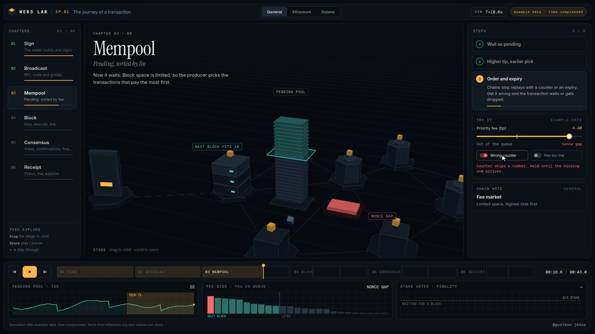
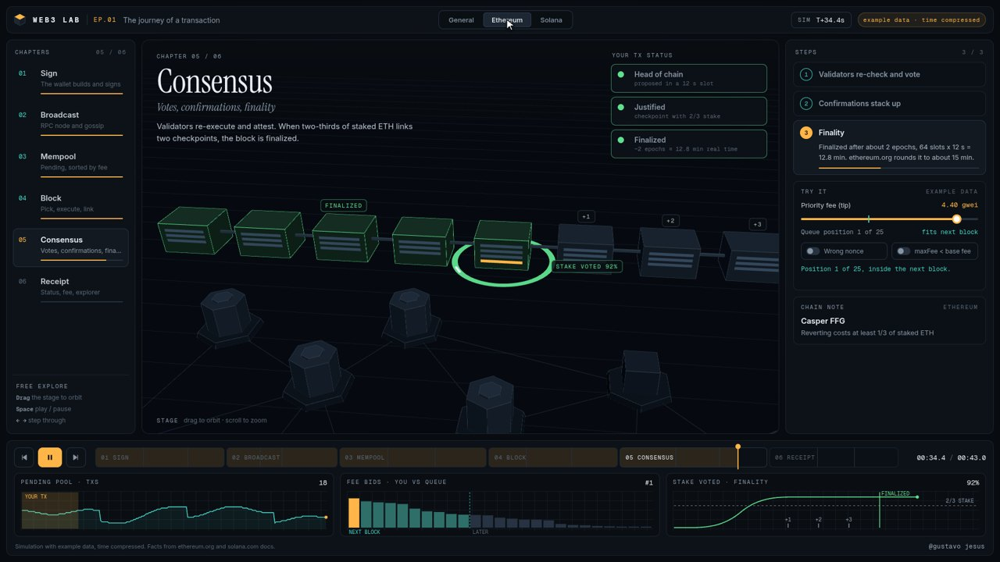

# Web3 Lab · Ep.01 · The journey of a transaction

An interactive 3D lab that follows one transaction from the moment a wallet signs it to the moment it is final. Switch between a general view, Ethereum and Solana and watch the same journey play out with each chain's real mechanics: signing, broadcast to an RPC node and gossip, the mempool (or the Solana leader queue), block production and execution, then votes, confirmations and finality.

**Live demo:** https://gustavojesuss69.github.io/web3lab/

| | | |
|---|---|---|
|  |  |  |

## Chapters

1. **Sign**: the wallet builds the transaction and signs it with the private key, and only the signature leaves
2. **Broadcast**: an RPC node checks it and spreads it to peers (or forwards it to upcoming leaders on Solana)
3. **Mempool**: it waits as pending, a higher tip gets picked earlier, and the nonce or recent blockhash sets order and expiry
4. **Block**: a proposer or leader is chosen, the transaction executes and updates state, and the block links to the previous one
5. **Consensus**: validators re-check and vote, confirmations stack up, then finality

## Controls

| Action | How |
|---|---|
| Jump to a chapter | Left navigation |
| Change chain | Top switch: General / Ethereum / Solana |
| Play, pause, step, scrub | Bottom timeline, `Space` to play or pause, arrow keys to step |
| Try it | Right panel: priority fee (tip) slider, plus failure toggles (wrong nonce, maxFee below base fee) |
| Camera | Drag the stage to orbit, scroll to zoom |

All addresses, hashes, block and slot numbers, queue sizes and fee values are example data and are labelled "example" in the UI. Time is compressed. The protocol facts come from the official docs listed in [docs/sources.md](docs/sources.md).

## Run it locally

Requires Node.js 20 or newer.

```bash
npm install
npm run dev       # dev server at http://localhost:5190
npm run build     # static build in dist/ (relative paths, host anywhere)
npm run preview   # serve dist/ at http://localhost:5191
```

## Deploying

Each push to `main` runs `.github/workflows/deploy.yml`, which builds with Vite and publishes `dist/` to GitHub Pages. In a fork, set **Settings → Pages → Source** to **GitHub Actions**.

## Rendering the video

The 58 second 1080p walkthrough is rendered frame by frame from a deterministic script (`src/script.js`).

1. `npm run build && npm run preview` (keep it running on port 5191)
2. `npm run render -- from=0 to=1740 dir=frames` (needs Google Chrome at `/usr/bin/google-chrome`, and frames that already exist are skipped)
3. `npm run render -- cues=out/cues.json` exports the sound cues
4. `pip install numpy scipy && npm run audio` writes `out/mix.wav`
5. `npm run encode` (needs ffmpeg) writes `out/web3lab-tx-journey.mp4`

## Project layout

```
index.html       layout and panels
src/main.js      app bootstrap, input, render loop, scripted video mode
src/stage.js     Three.js stage (wallet, nodes, mempool, blocks, validators)
src/sim.js       transaction journey simulation
src/content.js   chapter text for General, Ethereum and Solana
src/ui.js        panels, timeline, toggles
src/charts.js    small charts
src/script.js    video timeline
render.mjs       headless frame renderer (Puppeteer)
tools/           soundtrack and encode scripts
docs/sources.md  fact sources
```

## Credits

- Built with [Three.js](https://threejs.org/) and [Vite](https://vitejs.dev/)
- Fonts: Inter, Instrument Serif and Geist Mono (SIL Open Font License)
- Facts: ethereum.org and solana.com documentation, see [docs/sources.md](docs/sources.md)

## License

MIT © 2026 Gustavo Jesus
